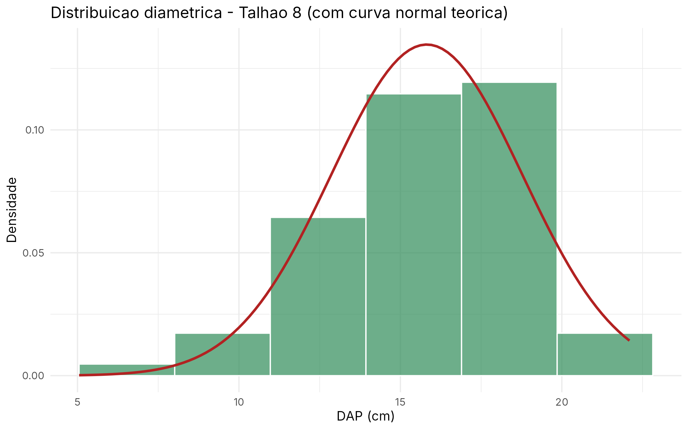
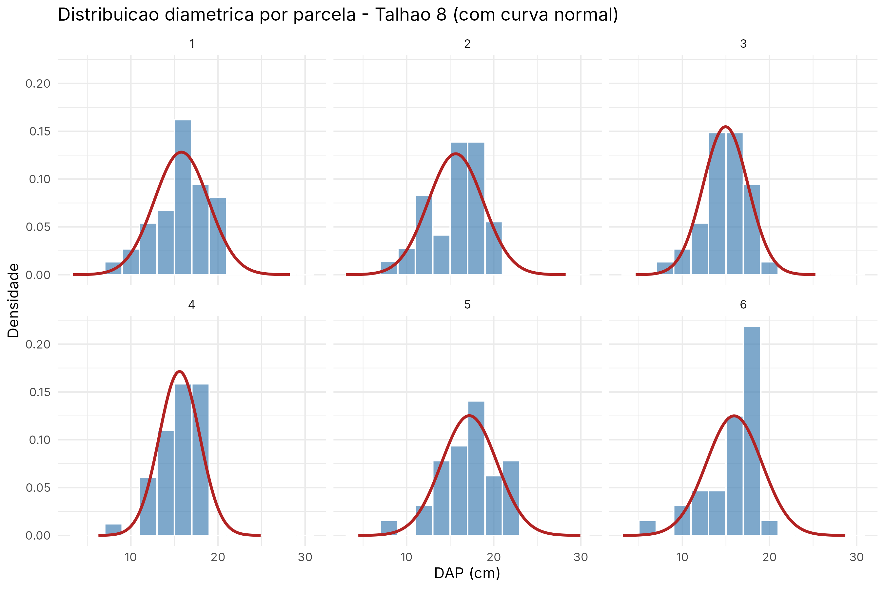

<div align="center">

# 🌲 Desafio 01 — Diâmetro

**Caracterização do DAP em inventário florestal de eucalipto**

   

*Disciplina Mensuração Florestal · Programa de Pós-Graduação em Ciências Florestais · ICA/UFMG*

</div>

## 📋 Objetivo

Auditar e caracterizar o diâmetro à altura do peito (DAP) de um inventário florestal real: estatísticas descritivas por parcela e no talhão, distribuição em classes de diâmetro, área basal, densidade por hectare e detecção de valores suspeitos.

## 🗂️ Dados

| Variável | Valor |
|---|---|
| Talhão | 8 (Filial 2) |
| Material | Eucalipto, clone 1501 |
| Idade | 7 anos |
| Espaçamento | 3 × 3 m |
| Amostragem | 6 parcelas, 215 árvores |
| Área do talhão | 48,7 ha |

Arquivo: [`dados/inventario.xlsx`](dados/inventario.xlsx).

## 🔧 Métodos

- Estatísticas descritivas do DAP por parcela e no talhão: média, diâmetro médio quadrático (dg), desvio-padrão, mínimo, máximo e coeficiente de variação.
- Classes de diâmetro com amplitude igual ao desvio-padrão de cada grupo.
- Área basal por parcela e por hectare, com a área da parcela estimada pelo espaçamento e pelo número de árvores por fileira.
- Expansão para o talhão do número de árvores com DAP ≥ 15 cm.
- Detecção de valores suspeitos e histogramas com curva normal teórica.

## 📈 Principais resultados

| Parcela | n | DAP médio (cm) | dg (cm) | CV (%) |
|:-:|:-:|:-:|:-:|:-:|
| 1 | 37 | 15,8 | 16,1 | 19,7 |
| 2 | 36 | 15,6 | 15,9 | 20,2 |
| 3 | 37 | 15,0 | 15,2 | 17,2 |
| 4 | 41 | 15,6 | 15,8 | 14,9 |
| 5 | 32 | 17,2 | 17,5 | 18,5 |
| 6 | 32 | 15,9 | 16,2 | 20,0 |
| **Talhão** | **215** | **15,8** | **16,1** | **18,7** |

- A parcela 5 é a mais desenvolvida (DAP médio de 17,2 cm); a parcela 4 é a mais homogênea (CV de 14,9%).
- Quase 70% das árvores estão nas duas classes centrais (13,9 a 19,9 cm), padrão típico de povoamento equiâneo.
- Área basal total amostrada: 4,37 m².
- Estimativa de cerca de 26.657 árvores com DAP ≥ 15 cm no talhão.

<p align="center">
  <br>
  <sub><b>Distribuição diamétrica do talhão com curva normal teórica</b></sub>
</p>

<p align="center">
  <br>
  <sub><b>Distribuição diamétrica por parcela</b></sub>
</p>

## 📁 Estrutura do repositório

```text
desafio-diametro-eucalipto/
├── dados/
│   └── inventario.xlsx            # inventário do talhão 8 (215 árvores)
├── scripts/
│   └── 01_analise_diametro.R      # análise completa
├── resultados/
│   ├── tabelas/                   # estatísticas, classes e área basal (CSV)
│   └── figuras/                   # histogramas
└── docs/
    ├── enunciado.pdf
    └── relatorio.pdf
```

## ▶️ Como executar

A partir da raiz do repositório:

```r
install.packages(c("readxl", "dplyr", "ggplot2"))
```

```bash
Rscript scripts/01_analise_diametro.R
```

## 📄 Documentos

- 📝 [Enunciado](docs/enunciado.pdf)
- 📊 [Relatório](docs/relatorio.pdf)

## 🧭 Série de desafios

| # | Desafio | |
|:-:|---|:-:|
| **01** | **Diâmetro** | 📍 você está aqui |
| 02 | [Altura e relação hipsométrica](https://github.com/danieldias936-cyber/desafio_altura) | |
| 03 | [Volume e forma](https://github.com/danieldias936-cyber/desafio_volume-e-forma) | |
| 04 | [Volume reduzido e equações de volume](https://github.com/danieldias936-cyber/desafio-04-volume-reduzido-e-tabela) | |
| 05 | [Taper e sortimento](https://github.com/danieldias936-cyber/desafio_taper_e_sortimento) | |
| 06 | [Amostragem de Bitterlich](https://github.com/danieldias936-cyber/desafio-06-bitterlich) | |
| 07 | Classificação de sítios florestais | ⏳ |
| 08 | [Validação do índice de sítio](https://github.com/danieldias936-cyber/desafio-08) | |
| 09 | [Crescimento e produção (Clutter)](https://github.com/danieldias936-cyber/desafio-09) | |

## 👤 Autor

**Daniel Dias** · [@danieldias936-cyber](https://github.com/danieldias936-cyber)  
Mestrado em Ciências Florestais — ICA/UFMG, Montes Claros (MG)
